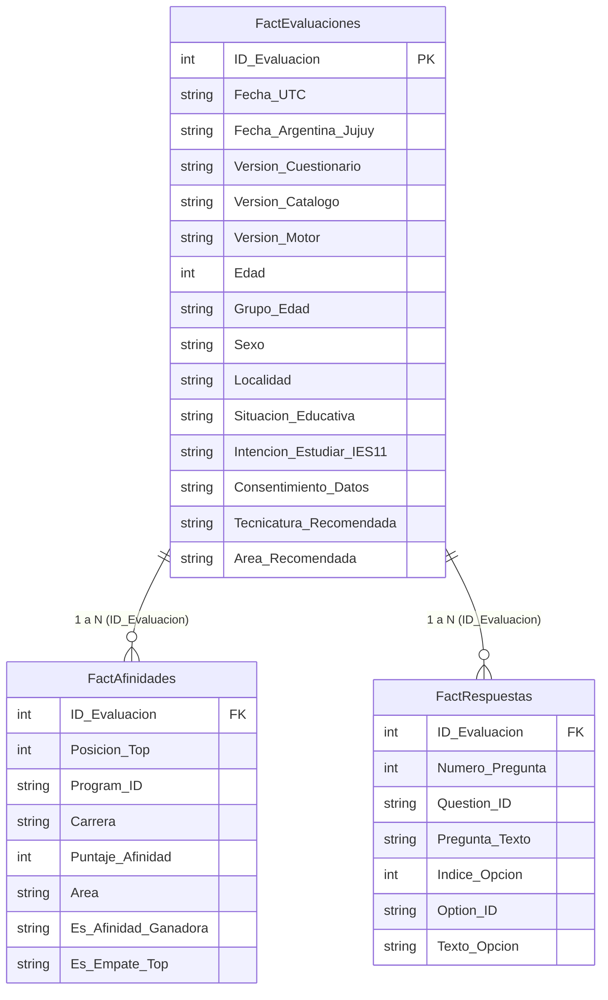

# Análisis Reproducible y Modelo Dimensional para Power BI

Este documento describe la arquitectura de datos analítica del **Test Vocacional IES N.° 11**, el esquema relacional en formato largo (*Long-Format Dimensional Model*) diseñado para herramientas de inteligencia de negocios como **Power BI**, y los procedimientos para la generación de informes reproducibles e inmutables.

---

## 1. De la Tabla Plana (Wide-Format) al Modelo Dimensional (Long-Format)

Durante la Expo Educativa 2026 original, el sistema exportaba un único archivo CSV plano con más de 100 columnas fijas (`P01_Opcion`, `P01_Texto`, ..., `Afinidad_1_Carrera`, `Afinidad_1_Puntaje`, etc.). Este formato presentaba graves limitaciones técnicas:
- **Rigidez estructural:** Si cambiaba el número de preguntas o el número de tecnicaturas en el catálogo, la estructura de columnas se rompía.
- **Dificultad de modelado en Power BI:** Requería complejas transformaciones de anulación de dinamización (*Unpivot Columns*) en Power Query.
- **Riesgo de privacidad:** Contenía columnas directas para nombre y apellido.

A partir de la versión actual, el procedimiento de exportación `exportCsv` descompone la información en **tres tablas de hechos dimensionales normalizadas en formato largo**:



---

## 2. Especificación de las Tablas de Hechos (FactTables)

### 2.1. `FactEvaluaciones.csv` (Tabla Principal de Evaluación y Demografía)
Representa una fila única por cada evaluación completada (granularidad: 1 fila = 1 evaluación).

| Columna | Tipo | Descripción y Ejemplos |
|---|---|---|
| `ID_Evaluacion` | Entero | Clave primaria anónima subrogada (`1`, `2`, `3`...). |
| `Fecha_UTC` | ISO 8601 | Fecha y hora en meridiano de Greenwich (`2026-08-19T14:30:00.000Z`). |
| `Fecha_Argentina_Jujuy` | String | Fecha y hora local con huso horario argentino (`2026-08-19T11:30:00-03:00`). |
| `Version_Cuestionario` | String | Versión del redactado de preguntas (`2026.08-redaccion-clara` o `2026.08-original`). |
| `Version_Catalogo` | String | Catálogo vigente al momento del test (`2026.10-oficial-17`, `2026.08-oficial-18`, etc.). |
| `Version_Motor` | String | Versión de cálculo psicométrico (`2026.10-ids-estables`). |
| `Edad` | Entero / Vacío | Edad numérica informada (opcional). |
| `Grupo_Edad` | Categórica | Rango etario clasificado (`13-15`, `16-18`, `19-25`, `26+`). |
| `Sexo` | Categórica | Género informado (`Femenino`, `Masculino`, `No binario`, `Prefiero no decir`). |
| `Localidad` | Texto | Localidad informada por el participante (`San Salvador de Jujuy`, `Palpalá`, etc.). |
| `Situacion_Educativa` | Categórica | Nivel de estudios alcanzado o cursando (`Secundario`, `Terciario`, etc.). |
| `Intencion_Estudiar_IES11`| Categórica| Respuesta a si planea estudiar en el IES N.° 11 (`Sí`, `Explorando`, etc.). |
| `Consentimiento_Datos` | Booleana | Consentimiento explícito de tratamiento estadístico (`Sí` / `No`). |
| `Tecnicatura_Recomendada`| Texto | Tecnicatura que obtuvo la 1.ª posición de afinidad. |
| `Area_Recomendada` | Categórica | Área a la que pertenece la tecnicatura ganadora. |

> [!NOTE]
> Esta tabla **no contiene columnas de nombre ni apellido**, cumpliendo con la política institucional de anonimización en origen (*Zero-PII*).

---

### 2.2. `FactAfinidades.csv` (Tabla de Afinidades y Puntajes)
Desglosa verticalmente todos los puntajes calculados para cada participante (granularidad: 1 fila = 1 tecnicatura evaluada por evaluación).

| Columna | Tipo | Descripción y Ejemplos |
|---|---|---|
| `ID_Evaluacion` | Entero | Clave foránea que referencia a `FactEvaluaciones.ID_Evaluacion`. |
| `Posicion_Top` | Entero | Posición en el ranking de afinidades (`1` = 1.er lugar, `2` = 2.º lugar, etc.). |
| `Program_ID` | String | Identificador canónico y estable de la carrera (`ts_enfermeria`, `ts_desarrollo_software`). |
| `Carrera` | Texto | Nombre institucional completo de la Tecnicatura Superior. |
| `Puntaje_Afinidad` | Entero | Puntuación normalizada de 0 a 100 calculada por el motor. |
| `Area` | Categórica | Área académica institucional a la que pertenece la tecnicatura. |
| `Es_Afinidad_Ganadora` | String | Indicador directo (`Sí` / `No`) si corresponde al 1.er puesto. |
| `Es_Empate_Top` | String | Indicador (`Sí` / `No`) si hubo un empate exacto en el puntaje más alto. |

---

### 2.3. `FactRespuestas.csv` (Tabla Ítem por Ítem de Respuestas)
Desglosa las 14 elecciones individuales tomadas por cada persona (granularidad: 1 fila = 1 pregunta respondida).

| Columna | Tipo | Descripción y Ejemplos |
|---|---|---|
| `ID_Evaluacion` | Entero | Clave foránea que referencia a `FactEvaluaciones.ID_Evaluacion`. |
| `Numero_Pregunta` | Entero | Número de orden del ítem del cuestionario (del `1` al `14`). |
| `Question_ID` | String | Identificador estable de la pregunta (`q_proposal`, `q_health_space`, etc.). |
| `Pregunta_Texto` | Texto | Enunciado completo de la situación planteada en el cuestionario. |
| `Indice_Opcion` | Entero | Posición ordinal de la opción elegida (`1`, `2`, `3`, `4`...). |
| `Option_ID` | String | Identificador canónico de la alternativa elegida (`opt_visual`, `opt_prototype`, etc.). |
| `Texto_Opcion` | Texto | Texto descriptivo de la alternativa seleccionada. |

---

## 3. Guía de Modelado y Medidas en Power BI

Al importar los tres archivos CSV en **Power BI Desktop**:

1. **Relaciones en el Modelo de Datos:**
   - Crear una relación de uno a varios (`1:*`) con dirección de filtro cruzado única desde `FactEvaluaciones[ID_Evaluacion]` hacia `FactAfinidades[ID_Evaluacion]`.
   - Crear una relación de uno a varios (`1:*`) con dirección de filtro cruzado única desde `FactEvaluaciones[ID_Evaluacion]` hacia `FactRespuestas[ID_Evaluacion]`.

2. **Medidas DAX Clave:**

```dax
// Total de evaluaciones únicas completadas
Total Evaluaciones = COUNTROWS(FactEvaluaciones)

// Cantidad de veces que una carrera fue la recomendación principal (Top 1)
Total Recomendaciones Top1 = 
CALCULATE(
    COUNTROWS(FactAfinidades),
    FactAfinidades[Posicion_Top] = 1
)

// Cantidad de presencias en el Top 3 (primeras tres afinidades)
Presencia en Top 3 = 
CALCULATE(
    COUNTROWS(FactAfinidades),
    FactAfinidades[Posicion_Top] <= 3
)

// Tasa de empates en el 1.er puesto
Tasa de Empates Top1 = 
DIVIDE(
    CALCULATE(
        COUNTROWS(FactEvaluaciones),
        USERELATIONSHIP(FactEvaluaciones[ID_Evaluacion], FactAfinidades[ID_Evaluacion]),
        FactAfinidades[Posicion_Top] = 1,
        FactAfinidades[Es_Empate_Top] = "Sí"
    ),
    [Total Evaluaciones],
    0
)

// Promedio de edad de participantes
Edad Promedio = AVERAGE(FactEvaluaciones[Edad])
```

---

## 4. Scripts de Análisis Reproducible

El script automatizado [`scripts/analyzeFinalCsv.py`](file:///mnt/c/Proyecto%20Test%20Vocacional%20IES%2011/Test_Vocacional_IES11_Paquete_Completo_v1.0.0/scripts/analyzeFinalCsv.py) permite procesar la exportación directamente desde la línea de comandos sin dependencias de interfaces gráficas:

```bash
python3 scripts/analyzeFinalCsv.py FactEvaluaciones-2026-10-12.csv \
  --markdown-output reportes/analisis_institucional.md \
  --json-output reportes/metricas_agregadas.json
```

El script genera métricas consolidadas, distribuciones por área, ratios de intención de inscripción y verifica que se cumplan las reglas de supresión de privacidad ($N < 3$) en todos los resúmenes demográficos.
