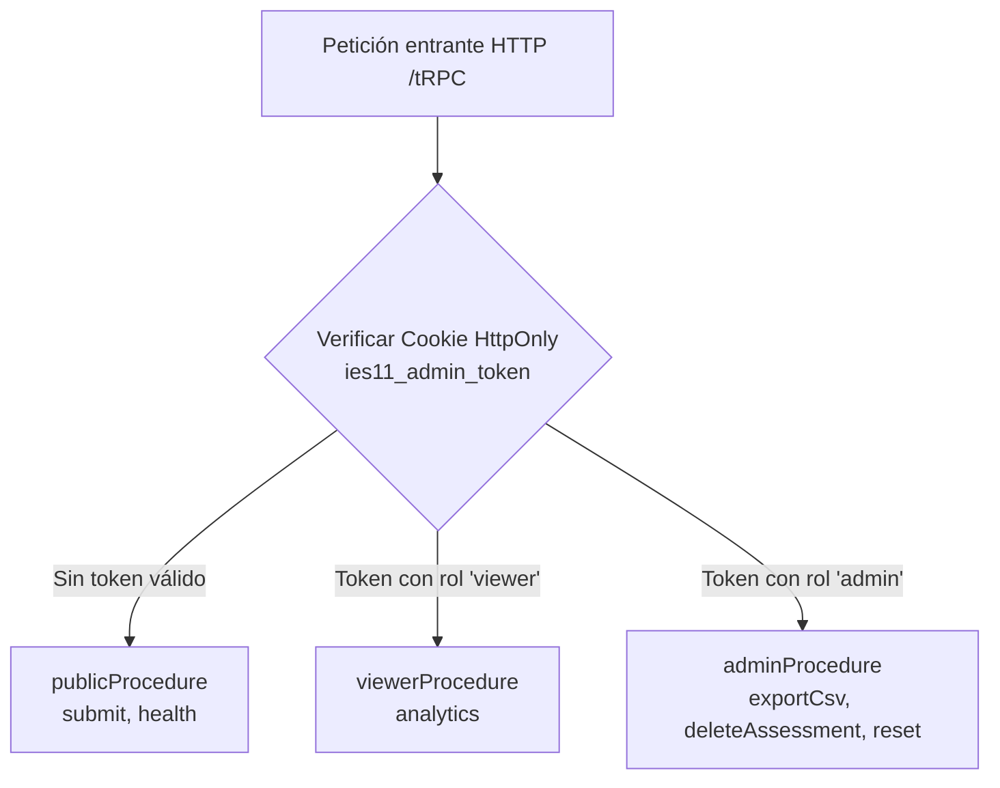

# Arquitectura Técnica

La plataforma del **Test Vocacional IES N.° 11** está concebida bajo una arquitectura web cliente-servidor desacoplada, autónoma y tipada de extremo a extremo (*End-to-End Type Safety*), diseñada para operar de forma independiente en infraestructura institucional propia sin dependencias de plataformas externas propietarias.

---

## 1. Pila Tecnológica Principal

```text
┌────────────────────────────────────────────────────────────────────────┐
│                        CLIENTE WEB (SPA)                              │
│   React 19 · Vite · TypeScript · Tailwind CSS · Framer Motion · wouter │
└───────────────────────────────────┬────────────────────────────────────┘
                                    │ Contratos Tipados (tRPC v11 + superjson)
                                    ▼
┌────────────────────────────────────────────────────────────────────────┐
│                        SERVIDOR DE APLICACIÓN                          │
│     Node.js · Express · tRPC Server · JWT (HMAC-SHA256) · Cookies      │
└───────────────────────────────────┬────────────────────────────────────┘
                                    │ Drizzle ORM (MySQL2 Driver)
                                    ▼
┌────────────────────────────────────────────────────────────────────────┐
│                        BASE DE DATOS RELACIONAL                        │
│                           MySQL 8.0 / MariaDB                          │
└────────────────────────────────────────────────────────────────────────┘
```

- **Frontend:** Single-Page Application (SPA) construida con React 19 y Vite 7. Estilos con Tailwind CSS y componentes accesibles de Radix UI. Gráficos interactivos con Recharts. Animaciones con Framer Motion y soporte de reducción de movimiento.
- **Backend:** Servidor Node.js con Express y tRPC v11, garantizando validación estricta de esquemas con Zod y serialización rica con superjson.
- **Capa de Dominio Compartida (`shared/`):** Tipos, definiciones del cuestionario, perfiles de carreras del IES N.° 11, ponderaciones vectoriales RIASEC y motor de cálculo de afinidades compartidos en tiempo de compilación entre frontend y backend.
- **Persistencia:** Drizzle ORM sobre MySQL/MariaDB con tipado estricto en inferencia de modelos e inserciones.
- **Assets 100% Locales:** Logotipos institucionales (`/ies11-logo.png`), iconos vectoriales de Lucide React y fuentes tipográficas residen íntegramente dentro del repositorio y del bundle estático compilado, garantizando funcionamiento autónomo offline o en redes privadas.

---

## 2. Capas de la Aplicación y Responsabilidades

| Capa | Directorio | Responsabilidad Principal |
|---|---|---|
| **Presentación** | `client/src/pages/`, `client/src/components/` | Flujo del cuestionario, registro demográfico, revelación accesible del Top 3, generación de PDF y tarjeta social, y panel de control administrativo. |
| **Librerías de Cliente** | `client/src/lib/` | Lazy loading de renderizadores pesados (`reportPdf.ts`, `socialCardDownload.ts`), cálculo de bandas de afinidad cualitativas (`affinityBands.ts`) y utilidades de transición. |
| **Rutas y Servicios** | `server/routers.ts` | Procedimientos tRPC organizados por niveles de autorización (`publicProcedure`, `viewerProcedure`, `adminProcedure`), validación de entradas y auditoría. |
| **Acceso a Datos** | `server/db.ts` | Consultas Drizzle, cálculo de analíticas agregadas con agregación SQL, supresión estricta de privacidad y exportación dimensional por lotes. |
| **Seguridad de Servidor** | `server/_core/` | Autenticación JWT en cookies HttpOnly, rate limiting adaptativo en memoria y middleware de contexto tRPC. |
| **Dominio Vocacional** | `shared/vocational.ts` | Definición de las 14 preguntas situacionales, 17 tecnicaturas activas vigentes, 1 tecnicatura en modelado, 2 perfiles retirados, asignación de vectores RIASEC y motor determinista. |
| **Archivo y Modos** | `shared/archive.ts` | Reglas de inmutabilidad para el modo de archivo histórico (`INSTANCE_MODE="historical"`). |

---

## 3. Seguridad y Control de Acceso por Roles

La API tRPC implementa una jerarquía estricta de tres procedimientos:



### 3.1. Gestión de Sesión
- **Token JWT:** Tras una autenticación exitosa en `adminAuth.login`, el servidor genera un token JWT firmado con HMAC-SHA256 utilizando el secreto del entorno `ADMIN_JWT_SECRET`.
- **Cookie Segura:** El token se almacena en una cookie `ies11_admin_token` con atributos:
  - `HttpOnly`: Impide acceso desde scripts JavaScript del cliente (mitigación de ataques XSS).
  - `SameSite=Lax`: Protege contra ataques de falsificación de peticiones en sitios cruzados (CSRF).
  - `Secure`: Se activa automáticamente en entornos HTTPS.
  - `Max-Age`: Vencimiento programado en 8 horas.

### 3.2. Procedimientos Protegidos
1. `publicProcedure`: Utilizado por el participante para enviar su evaluación (`vocational.submit`). No requiere credenciales.
2. `viewerProcedure`: Permite a docentes o directivos con rol de visualizador consultar el dashboard de estadísticas agrupadas (`vocational.analytics`), pero bloquea operaciones sensibles.
3. `adminProcedure`: Restringido exclusivamente al rol `admin`. Controla:
   - `exportCsv`: Exportación dimensional de microdatos normalizados para Power BI.
   - `deleteAssessment`: Eliminación quirúrgica de un registro por ID ante solicitud de ejercicio de derechos de privacidad.
   - `createResetChallenge` y `reset`: Flujo de reinicio de base de datos con desafío criptográfico y descarga obligatoria previa de respaldo (`backupReceipt`).

### 3.3. Mitigación de Fuerza Bruta (Rate Limiting)
El middleware `enforceAdminRateLimit` limita intentos de inicio de sesión y llamadas administrativas por IP con bloqueo temporal exponencial para prevenir ataques automatizados de adivinación de credenciales.

---

## 4. Flujo de Datos y Modelo de Privacidad Zero-PII

El sistema adopta el principio de **Privacidad desde el Diseño** (*Privacy by Design*):

1. **Entrada de Datos:** En el cuestionario, el participante puede ingresar opcionalmente su nombre y apellido.
2. **Uso Exclusivo en Memoria RAM del Cliente:** Estos datos se almacenan temporalmente en el estado de React (`localStorage` o memoria del navegador) para personalizar el reporte PDF individual o la tarjeta social.
3. **Persistencia en Servidor (Zero-PII):** Al ejecutar la mutación `vocational.submit`, en modo permanente (`INSTANCE_MODE="permanent"`), los campos `firstName` y `lastName` se persisten como `null` en la tabla `vocational_assessments`. Solo se guardan atributos demográficos no identificatorios (rango etario, sexo, localidad, intención de estudio) junto con el vector de respuestas y el resultado calculado.
4. **Al Cierre de Pestaña:** El nombre del participante desaparece de la memoria volátil del navegador.

---

## 5. Rendimiento y Carga Bajo Demanda (Lazy Loading)

Para mantener el bundle principal de JavaScript liviano (~280 kB gzipped) y garantizar tiempos de carga rápidos en conexiones móviles del norte argentino, las librerías pesadas de renderizado gráfico se cargan de forma diferida:

- **`jspdf` (~390 kB) y `html2canvas` (~200 kB):** Se dividen en chunks independientes (`jspdf.es.min-*.js`, `html2canvas.esm-*.js`) y se cargan mediante `await import('jspdf')` únicamente en el momento exacto en que el usuario presiona "Descargar informe en PDF".
- **`html-to-image` (~160 kB):** Se importa dinámicamente solo al solicitar "Descargar tarjeta social".
- **`qrcode`:** Empaquetado de forma modular para la generación del enlace de preinscripción institucional.

---

## 6. Accesibilidad (a11y) y Experiencia Móvil

- **Zoom Móvil Habilitado:** El encabezado `<meta name="viewport">` en `client/index.html` prescinde de `maximum-scale=1` o `user-scalable=no`, permitiendo a personas con discapacidad visual ampliar la interfaz con gestos táctiles pellizcar para hacer zoom (*pinch-to-zoom*).
- **Reducción de Movimiento:** Las animaciones de revelación de resultados ([`resultRevealAnimation.ts`](file:///mnt/c/Proyecto%20Test%20Vocacional%20IES%2011/Test_Vocacional_IES11_Paquete_Completo_v1.0.0/client/src/lib/resultRevealAnimation.ts)) consultan el media query `prefers-reduced-motion: reduce`. Si el participante tiene activada esta preferencia en su sistema operativo, las transiciones se desactivan o ejecutan de forma instantánea.
- **Touch Targets:** Botones, tarjetas de selección y controles interactivos cumplen con el estándar mínimo de 44×44 píxeles para evitar pulsaciones erróneas en pantallas táctiles de teléfonos celulares.

---

## 7. Modelo Dimensional para Power BI

La exportación de datos ([`exportDimensionalCsv`](file:///mnt/c/Proyecto%20Test%20Vocacional%20IES%2011/Test_Vocacional_IES11_Paquete_Completo_v1.0.0/server/db.ts#L710-L785)) transforma los registros a un esquema en estrella normalizado en formato largo:

1. **`FactEvaluaciones`:** Registro único por evaluación con dimensiones demográficas y de catálogo.
2. **`FactAfinidades`:** Tabla relacional de afinidades unroll con `ID_Evaluacion`, `Program_ID` estable, ordinal Top, puntaje y empates.
3. **`FactRespuestas`:** Tabla relacional ítem por ítem con `ID_Evaluacion`, `Question_ID` estable y `Option_ID` estable.

La consulta se procesa en lotes de 500 registros con control de memoria RAM y escapado preventivo contra inyección de fórmulas CSV (CWE-1236).
